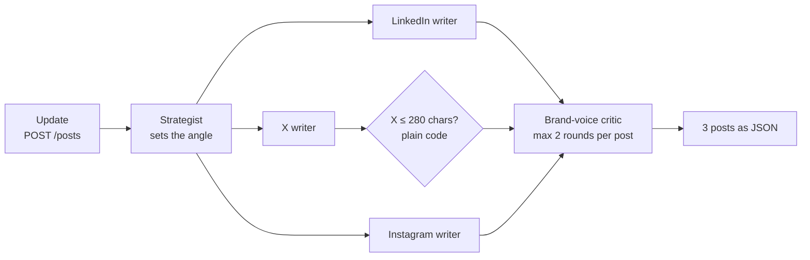

# Social agents lab

Build your first multi-agent app on Cloudflare, all in the browser.
A 35-minute workshop by Salman Shaikh, MONARC STUDIOS.

[](https://codespaces.new/monarcpro/social-agents-lab?quickstart=1)

You type one product update. Five small AI agents turn it into a post for LinkedIn, X and Instagram, and check each post before it goes out.



- **Orchestrator-worker:** the route is the orchestrator. A strategist agent sets the angle, then three platform writers run at the same time with `Promise.all`.
- **Critic loop:** a brand-voice critic checks each post (on topic, no hype words, no invented facts). Not OK? The writer rewrites, at most 2 rounds, then the post is marked for a human.
- **Not every check needs a model:** an X post over 280 characters is caught by one line of plain code.

Stack: [Cloudflare Workers](https://developers.cloudflare.com/workers/), [Blaze](https://blaze.monarcpro.app/) (Express-style routes for Workers), [Workers AI](https://developers.cloudflare.com/workers-ai/) (Llama 3.1 8B) and [Wrangler](https://developers.cloudflare.com/workers/wrangler/), inside [GitHub Codespaces](https://github.com/features/codespaces). Nothing to install on your laptop.

## Before the session (10 minutes, at home)

1. Create a free [GitHub](https://github.com/signup) account and a free [Cloudflare](https://dash.cloudflare.com/sign-up) account.
2. Click **Open in GitHub Codespaces** above, then **Create codespace**. Use your **personal** GitHub account (see the free allowance below). The first start takes a minute or two while `npm install` runs.
3. In the codespace terminal, log in to Cloudflare:

   ```bash
   npx wrangler login --device
   ```

   It prints a URL and a code. Open the URL in any browser, check the code matches, and click **Allow**.
4. Check it worked with `npx wrangler whoami`, then close the tab. The codespace stops on its own and resumes in a few seconds at the workshop (the badge's `quickstart` link offers your existing codespace).

Why `--device`? Plain `npx wrangler login` waits for a callback on `localhost:8976`, which your browser can't reach inside a codespace. The device flow needs Wrangler 4.119.0 or newer; this repo pins it.

## The lab: 5 steps, 22 minutes

Everything happens in one file, `src/index.ts`. Keep `npx wrangler dev` running: it reloads every time you save.

**Behind?** Copy the finished file for any step and keep going, for example:

```bash
cp steps/step-3.ts src/index.ts
```

### Step 1 · Set up (4 min)

1. Open your codespace and run:

   ```bash
   npx wrangler dev
   ```

   You should see `Ready on http://0.0.0.0:8787`.
2. Open the **Ports** tab, find **8787 · Social agents test page** and click the globe icon (*Open in Browser*).
3. Click **Write posts**. You see three placeholder posts: the route is a stub with no AI yet.

### Step 2 · One agent (3 min)

An agent is a model with a role. One function makes every agent in this app: the role goes in as the system message, the input as the user message.

Add this under `const app = createApp<Env>();`:

```ts
const MODEL = "@cf/meta/llama-3.1-8b-instruct-fp8-fast";

// Step 2 · an agent is one model call with a role
async function agent(env: Env, role: string, input: string) {
  const out = await env.AI.run(MODEL, { messages: [
    { role: "system", content: role },
    { role: "user", content: input } ] });
  return (out as { response: string }).response.trim();
}
```

Then replace the whole `app.post("/posts", …)` stub with:

```ts
// Step 2 · one agent writes one post (step 3 replaces this route)
app.post("/posts", async (req, res) => {
  const { update } = await req.json<{ update: string }>();
  const post = await agent(req.env, "You write LinkedIn posts: " +
    "3 short paragraphs, end with a question.", update);
  res.json({ posts: [{ platform: "linkedin", post }] });
});
```

Save, then click **Write posts**: one real LinkedIn post.

### Step 3 · A strategist briefs three writers (6 min)

A strategist agent sets the angle first. Then the route sends the work to three writers at once, one per platform, each role carrying that platform's rules.

Add this under the `agent` function:

```ts
// Step 3 · a strategist sets the angle; one writer per platform
const strategist = "You are a social media strategist. In one " +
  "sentence, say who this update is for and the one point " +
  "every post must make.";
const writers = {
  linkedin: "You write LinkedIn posts: 3 short paragraphs, " +
    "end with a question. Reply with the post only.",
  x: "You write posts for X: under 280 characters, " +
    "at most 2 hashtags. Reply with the post only.",
  instagram: "You write Instagram captions: a hook line, " +
    "2 short lines, 5 hashtags. Reply with the caption only.",
};
type Platform = keyof typeof writers;

async function write(env: Env, platform: Platform, task: string) {
  let post = await agent(env, writers[platform], task);
  return { platform, post }; // step 4 replaces this line
}
```

Then replace the route with:

```ts
// Step 3 · the orchestrator: brief first, then 3 writers at once
app.post("/posts", async (req, res) => {
  const { update } = await req.json<{ update: string }>();
  const brief = await agent(req.env, strategist, update);
  const task = `Update: ${update}\nBrief: ${brief}`;
  const platforms = Object.keys(writers) as Platform[];
  const posts = await Promise.all(
    platforms.map((platform) => write(req.env, platform, task)));
  res.json({ brief, posts });
});
```

Save and try it: a brief and three posts. `Promise.all` runs the three writers in parallel, so three posts take about as long as one.

### Step 4 · Critic loop (5 min)

A brand-voice critic checks every post. If it isn't OK, the writer rewrites with the critic's note, at most 2 rounds, then the post is marked for a human. The X length check is plain code: no model needed to count characters.

Add the critic above `write`:

```ts
// Step 4 · a brand-voice critic checks every post
const critic = "Reply with the one word OK if the post is on " +
  "topic, has no hype words (game-changing, revolutionary) " +
  "and adds no facts beyond the update. If not, say what to fix.";
```

Then replace the `return { platform, post };` line inside `write` with the loop:

```ts
  const notes: string[] = [];
  for (let round = 1; round <= 2; round++) {
    const verdict = platform === "x" && post.length > 280 // no AI
      ? `Too long: ${post.length} characters. Cut to 280.`
      : await agent(env, critic, `${task}\nPost: ${post}`);
    notes.push(verdict);
    if (verdict.toUpperCase().startsWith("OK")) {
      return { platform, post, rounds: round, notes };
    }
    post = await agent(env, writers[platform],
      `${task}\nYour draft: ${post}\nFix this: ${verdict}`);
  }
  return { platform, post, notes, note: "needs a human" };
```

The test page now shows each critic round under its post.

### Step 5 · Test and deploy (4 min)

1. On the test page, try the three sample updates. Your posts will differ from your neighbour's: that's the model, not a bug.
2. Put it online:

   ```bash
   npx wrangler deploy
   ```

   On a brand-new Cloudflare account, Wrangler may ask you to pick a `workers.dev` subdomain first.
3. Open the URL it prints, `https://social-agents.<your-subdomain>.workers.dev`. The same test page is now live.

The finished file is [`steps/step-4.ts`](steps/step-4.ts): 66 lines, comments included.

## Free allowances (checked 31 Oct 2026)

| What | Free | Notes |
| --- | --- | --- |
| GitHub Codespaces | 120 core hours + 15 GB-month storage a month (GitHub Free, personal accounts) | The default 2-core machine uses 2 core hours per hour, so about **60 hours**. With no payment method on file, usage stops at the limit: you are never billed. Codespaces owned by an **organization** get no free allowance, so open it from your personal account. |
| Cloudflare Workers | Free plan | `workers.dev` URL included. |
| Workers AI | 10,000 Neurons a day, every account, reset at 00:00 UTC | On the Workers Free plan, calls past the limit fail with an error: no bill. Llama 3.1 8B (fp8-fast) costs $0.045 / $0.384 per million input / output tokens on a paid plan. One run of the finished app is a few thousand tokens; our estimate is 40 to 60 Neurons, so roughly 200 runs a day for free. |

Use `@cf/meta/llama-3.1-8b-instruct-fp8-fast` for the lab. Some larger models (Kimi, GLM, DeepSeek V4) need a paid Workers plan.

## Troubleshooting

- **The login page never comes back to the codespace.** Use `npx wrangler login --device`, not plain `wrangler login`.
- **Device login won't work for you.** Fallback: create an API token in the Cloudflare dashboard (*My Profile → API Tokens*, template *Edit Cloudflare Workers*, and add the Workers AI permission), then in the codespace terminal run `export CLOUDFLARE_API_TOKEN=<your token>` before `npx wrangler dev`. It lasts for that terminal only.
- **Port 8787 isn't in the Ports tab.** Click *Forward a Port* and type `8787`.
- **`npx wrangler dev` asks you to log in.** Workers AI always runs on Cloudflare, even in dev, so you must be logged in first.
- **An error about the daily free allocation.** You've used your 10,000 free Neurons for today. They reset at 00:00 UTC; nothing is billed on the Free plan.
- **Everything is stuck.** `cp steps/step-4.ts src/index.ts` gives you the finished app.

## After the workshop

- Your app is public: anyone with the URL can use it, on your free Neurons. Take it down with `npx wrangler delete`.
- Stop or delete the codespace at [github.com/codespaces](https://github.com/codespaces) so it doesn't use your storage allowance.
- Next steps: the planner-executor pattern; the [Agents SDK](https://developers.cloudflare.com/agents/) for memory per user; [Workflows](https://developers.cloudflare.com/workflows/) for long tasks with retries; [AI Gateway](https://developers.cloudflare.com/ai-gateway/) for logs, caching and fallbacks.

## Sources

- GitHub Codespaces billing: https://docs.github.com/en/billing/concepts/product-billing/github-codespaces
- Wrangler device login (Wrangler 4.119.0): https://developers.cloudflare.com/changelog/post/2026-08-04-wrangler-login-device-flow/
- Workers AI pricing: https://developers.cloudflare.com/workers-ai/platform/pricing/
- Blaze docs: https://blaze.monarcpro.app/
